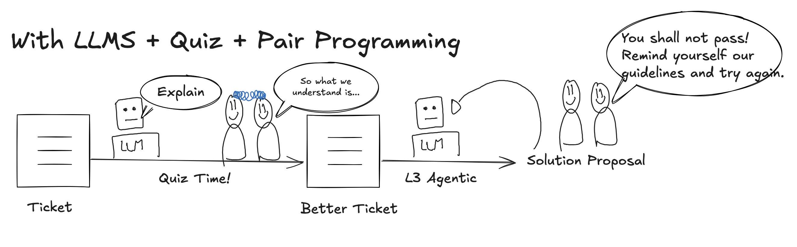

# skills

Claude Code skills by Marine Raimbault.

## learn

Keep learning while an AI agent writes your code.



`/learn` turns an issue, a pull request, a plan, a piece of code or a plain topic into a short tutoring session:

1. **A briefing** in plain words: how it worked before, what changes, the one line to remember, and for code the one core file to start from.
2. **One question at a time.** You answer before you see the agent's pick. The feedback ties the answer to an idea from a classic software book.
3. **A recap** in your own words after about three questions, corrected where it is off.
4. **1–3 Anki cards** for what was hard, checked by a fresh sub-agent before they are added.

More modes:

```
/learn <issue | PR | plan | code>   learn from work, decide on plans
/learn <topic>                      e.g. /learn vue routing
/learn handoff <text>               catch up on a teammate's handoff, ~20 min
/learn ready <PR>                   can I defend this change before I ask for review?
/learn review                       due Anki cards, then new learn cards
/learn help                         the command card, and how to set up Anki
```

A real session, written up: [Solving a bug with an AI agent as a junior developer, and still learning](https://marine-raimbault.com/posts/solving-a-bug-with-an-ai-agent-as-a-junior-developer/).

### Install

As a Claude Code plugin:

```
/plugin marketplace add marine-raimbault/skills
/plugin install learn@marine-raimbault-skills
```

Or with the skills CLI:

```
npx skills add marine-raimbault/skills
```

### Requirements

- [Claude Code](https://docs.claude.com/en/docs/claude-code).
- Optional, for the cards: the [Anki](https://apps.ankiweb.net/) desktop app with the [AnkiConnect](https://ankiweb.net/shared/info/2055492159) add-on. Without it, the cards are shown as text. `/learn help` explains the setup.
- Optional, for pull requests: the [GitHub CLI](https://cli.github.com/) (`gh`).
- Optional, for issues: access to your issue tracker, so the skill can read the ticket itself. For example an MCP server for your tracker (GitHub, GitLab or Linear all have one), or the tracker's CLI. I use it with Linear through its MCP server: `/learn ABC-123` reads the issue, its comments and linked PRs before the first question.

### Configuration

| Variable | Default | Meaning |
|----------|---------|---------|
| `LEARN_LOG_DECK` | `Learning Log` | Deck for personal cards: mistakes, predictions, trial and error |
| `LEARN_CONCEPTS_DECK` | empty | Deck tree for general concept cards; empty → they go to `LEARN_LOG_DECK` too |

Set them in the `env` block of `~/.claude/settings.json`.

### Credits

- Card rules: Piotr Wozniak, *Twenty rules of formulating knowledge*; Andy Matuschak, *How to write good prompts: using spaced repetition to create understanding*; the research on retrieval practice and spacing.
- Book ideas in the feedback: Michael Feathers, *Working Effectively with Legacy Code*; Martin Fowler, *Refactoring*; Michael Nygard, *Release It!*; Beyer et al., *Site Reliability Engineering*; Winters, Manshreck & Wright, *Software Engineering at Google*; Martin Kleppmann, *Designing Data-Intensive Applications*; Gerard Meszaros, *xUnit Test Patterns*; John Ousterhout, *A Philosophy of Software Design*; Hunt & Thomas, *The Pragmatic Programmer*; Forsgren, Humble & Kim, *Accelerate*.
- Spaced repetition: [Anki](https://apps.ankiweb.net/), [AnkiConnect](https://foosoft.net/projects/anki-connect/), and the FSRS scheduler.

## License

[MIT](LICENSE)
